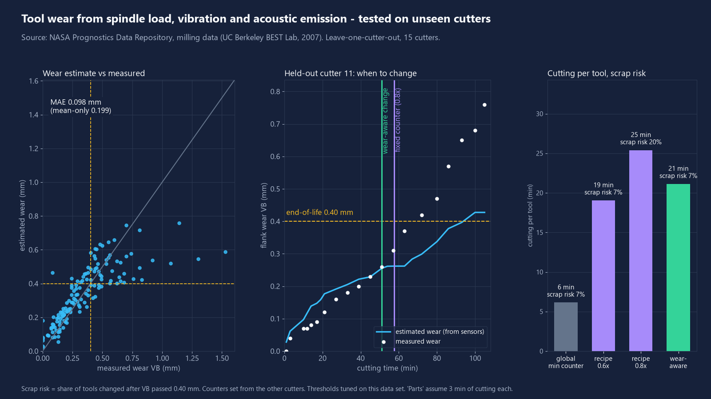
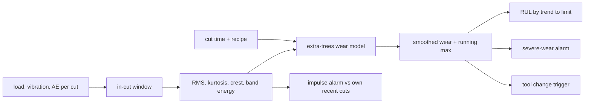

# tool-wear-detector

Estimate cutting-tool wear and remaining life in precision machining from spindle load, vibration and acoustic emission, and recommend the tool change instead of using a fixed counter.



*Real open data (NASA milling-wear set), 15 cutters, every cutter held out of training once. Left: estimated vs measured flank wear. Middle: one held-out cutter. Right: cutting per tool and scrap risk per policy.*

## What it does

- Computes explainable features per cut: RMS, kurtosis, crest factor, spectral band energy and the spindle-load level (the spindle-power trend), on the steady in-cut window found from the load channel.
- Estimates flank wear VB with one learned model (extra-trees regression, 300 trees, scikit-learn).
- Predicts remaining useful life (RUL) by extrapolating the smoothed wear trend to a wear limit (0.40 mm here).
- Raises two alarms: a severe-wear alarm (VB at or above 0.60 mm, a proxy for chipping risk) and an impulse alarm for sudden breakage-like events, both at a fixed 5 percent false-alarm rate.
- Recommends the tool change when smoothed wear reaches the limit minus a margin, and compares that to fixed tool-life counters (cutting minutes, scrap risk, unused life).

## Results

Data: NASA Prognostics Data Repository milling data (UC Berkeley BEST Lab, 2007): 16 cutters and 167 cuts; one cutter with a single cut is dropped, leaving 15 cutters, 166 cuts and 145 with measured VB. Split by cutter (leave-one-cutter-out), so a test cutter is never seen in training. All numbers below come from `python -m toolwear demo`, stored in `docs/results.json`.

| Metric | Value |
|---|---|
| Wear MAE, sensors + cut time + recipe | 0.098 mm |
| Wear MAE, cut time + recipe only (no sensors) | 0.095 mm |
| Wear MAE, sensors + recipe only (no cut time) | 0.140 mm |
| Wear MAE, predicting the mean | 0.199 mm |
| RUL MAE to VB 0.40 mm (82 points) | 13.8 min (counter: 17.3) |
| RUL MAE in the last 15 min of life (42 points) | 9.5 min (counter: 11.2) |
| Severe-wear alarm: run recall at 0 percent false alarms (target 5) | 60 percent |
| Severe-wear alarm: tools caught before first severe cut | 6 of 10, median lead -0.1 min (no early warning) |
| Impulse alarm on injected breakage, 5 percent false alarms: mild / moderate / severe | 5 / 5 / 64 percent recall |

Tool-change policy, 15 tools, 1 part = 3 min of cutting (an assumption), scrap risk = share of tools changed after VB passed 0.40 mm:

| Policy | Cutting per tool (min) | Parts per tool | Scrap risk | Unused life (min) |
|---|---|---|---|---|
| Fixed counter, shortest known life | 6.1 | 2.0 | 7 percent | 24.3 |
| Fixed counter per recipe, 0.6x mean life | 19.0 | 6.3 | 7 percent | 11.9 |
| Fixed counter per recipe, 0.8x | 25.4 | 8.5 | 20 percent | 6.1 |
| Fixed counter per recipe, 1.0x | 31.7 | 10.6 | 53 percent | 1.9 |
| Wear-aware (trigger at 0.25 mm) | 21.1 | 7.0 | 7 percent | 9.2 |

At the same 7 percent scrap risk, the wear-aware policy gets +5.0 parts per tool over the shortest-life counter and +0.7 parts (+11 percent) over the per-recipe 0.6x counter. A per-recipe counter set closer to the mean life cuts more but scraps more (20 to 53 percent). One tool is 6.7 percent, so these differences are small samples.

What the numbers say, plainly: the learned model beats guessing the mean by a wide margin, but on this data the sensors do not improve the wear estimate over cut time plus recipe (0.098 vs 0.095 mm). The gain from sensing here comes from adapting the change point to each tool, not from a better wear regressor. Trigger margin sweep (mm, mean cutting min, scrap risk): 0.00 32.8 / 67 percent; 0.05 28.7 / 53; 0.10 25.3 / 33; 0.15 21.1 / 7; 0.20 16.8 / 0.

## Quick start

```bash
pip install -e ".[dev]"
python -m toolwear demo        # downloads ~15 MB into cache/, runs everything, writes docs/
python -m toolwear fetch       # download only
python -m toolwear figures     # redraw figures from docs/results.json
pytest -p no:asyncio && ruff check .
```

The demo takes about a minute on one CPU core.

## How it works



- Cut window: samples where the load channel is above the midpoint between idle and peak, trimmed 10 percent at each end.
- Smoothing: exponential (alpha 0.5) then running maximum, because wear does not recover.
- RUL: line fitted to the last 6 smoothed wear values, extrapolated to 0.40 mm, capped at 120 min.
- Alarm thresholds are set from the held-out predictions at a fixed false-alarm rate (5 percent). Negative class: VB below 0.40 mm. Positive class: VB at or above 0.60 mm.
- Impulse alarm: robust z-score of crest, kurtosis and load level against the same tool's last 5 cuts. The dataset has no labelled breakage, so events are injected into real cuts (impulse burst of 6/12/24 sigma and a 10/20/40 percent load step) and labelled as injected.
- Fixed counters are set from the other cutters only (shortest known life, or mean life of the same material, depth of cut and feed times a safety factor).

## Data sources

- A. Agogino and K. Goebel (2007). BEST Lab, UC Berkeley. "Milling Data Set", NASA Prognostics Data Repository, NASA Ames Research Center, Moffett Field, CA. Download: `https://phm-datasets.s3.amazonaws.com/NASA/3.+Milling.zip` (checksum verified by `toolwear fetch`).
- Licence check (2026-11-09): the NASA open data catalogue entry "Milling Wear" lists the licence as https://www.usa.gov/government-works. The repository page asks users to acknowledge the repository and the donors, which this README does. The data is donated by a university lab; third-party rights are not independently verified.
- Decision: the data is not stored in this repo. It is downloaded into the gitignored `cache/` on demand, and only derived metrics and figures are published here. The PHM Society 2010 milling data was not used.
- Sampling is 250 Hz as provided, so the "acoustic emission" channels are low-rate records and not a high-frequency AE spectrum.

## What is not verified yet

- No real machine: nothing here ran on a shop-floor machine or in a control loop.
- No watchmaking-scale micro tools: the data is a lab face-milling set with 16 inserts, nowhere near micro-tool geometry, spindle speed or signal levels.
- Thresholds, the wear-limit margin and the feature list were chosen on this same data set. Reported numbers are optimistic for new data.
- Only 15 usable cutters (2 materials, 2 depths of cut, 2 feeds). One tool changes a percentage by 6.7 points.
- No labelled breakage: the severe-wear alarm is a proxy (VB at or above 0.60 mm) and the impulse alarm is tested only on injected synthetic events. Mild and moderate injected events are not detected.
- Sensors do not beat cut time plus recipe for wear regression here (0.098 vs 0.095 mm), and the severe-wear alarm gives no early warning (median lead -0.1 min).
- Part counts assume 3 min of cutting per part. Scrap risk is derived from interpolated measured wear, not from inspected parts.
- Turning and other operations are not covered by any data.

## Licence

MIT, Copyright (c) 2026 Victor Bonilla. See `LICENSE`. The data set keeps its own terms (above).
